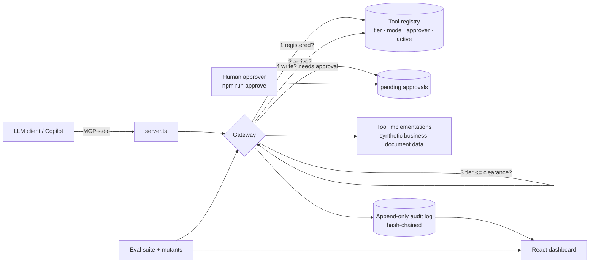

# governed-agent-gateway

A small, runnable reference for **letting an AI agent work on business-document data without losing control of it**. An MCP server whose every tool call goes through a governance gateway (registry, data tiers, human approval, hash-chained audit log), plus a saved eval suite that proves those controls hold, and a dashboard that shows it.

> **Synthetic data only.** Every record is generated in `src/data/seed.ts`. No employer code, schemas, system names or customer data are used. Built with AI coding assistants; I designed the controls and reviewed and tested the result.

## Architecture



## What it enforces

| Control | Behaviour |
|---|---|
| Registry | A tool that is not registered, or switched off, is refused. |
| Data tiers | Tier 1 metadata · 2 aggregated/masked · 3 schema-aware inside perimeter · 4 human-in-the-loop. A caller's clearance must cover the tool's tier. |
| Approval | Write tools never execute on the model's call. They create a pending approval; only the registered approver can release it, once, through a path that is **not** an MCP tool. |
| Audit | Every call, allowed or denied, is logged with an args hash. Entries are hash-chained, so editing history is detected. |

## Evals

`npm run evals` runs 15 saved cases against the gateway and records the score in `evals/history.jsonl`, so versions can be compared. Cases tagged *hard* (tier breach, unapproved write, unregistered tool) fail the run on a single miss.

`npm run evals:mutants` switches each control off in turn and checks the suite **catches** it. An eval that cannot fail is not an eval.

**Scope, stated plainly:** these evals test the governance layer deterministically. They do not score model behaviour (tool choice, answer quality). That is the next layer: LLM-in-the-loop cases with a rubric, run against the same gateway.

## Run it

```bash
npm install
npm test                       # typecheck + evals + mutants + MCP smoke test
npm run serve                  # MCP server on stdio (GATEWAY_CLEARANCE=1..4, default 3)
npm run approve -- <id> process-owner
npm run export && cd web && npm install && npm run dev   # dashboard
```

Add to an MCP client, e.g. `{"command":"npx","args":["tsx","src/server.ts"]}` from this folder.

## Limits

State is in memory plus JSON files; this is a reference, not a production service. The approval script re-creates the synthetic data, so a released write is audited but does not persist across processes. See `docs/adr/0001-gateway-in-front-of-tools.md` for the design reasoning.
